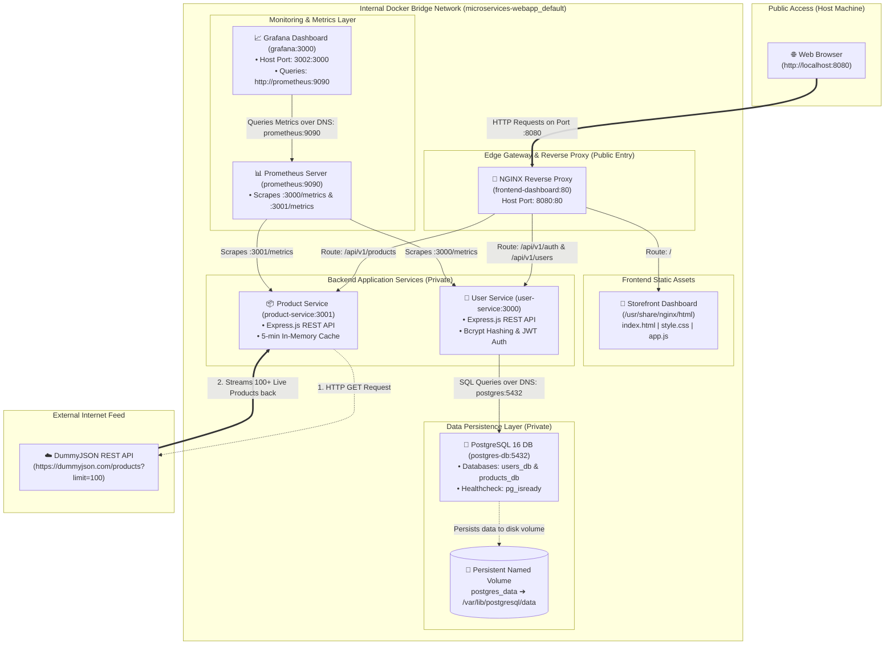

# 🚀 Cloud-Native Microservices Web Application & CI/CD Pipeline

A modern, enterprise-grade cloud-native microservices application built with **Node.js/Express** and **PostgreSQL**, containerized with **Docker**, orchestrated locally via **Docker Compose**, deployed on **Kubernetes** using **Helm**, monitored with **Prometheus & Grafana**, and automated end-to-end with **GitHub Actions CI/CD** publishing to **GitHub Container Registry (GHCR)**.

---

## 🏛️ System Architecture



---

## 💡 How It Works

1. **Edge Reverse Proxy & Routing (NGINX on port 8080):**  
   All client browser traffic enters through port `8080`. NGINX serves the compiled static frontend files for root paths (`/`) and acts as a reverse proxy for API routes (`/api/v1/auth`, `/api/v1/users`, `/api/v1/products`), forwarding requests to the appropriate backend containers across the private Docker network without triggering browser CORS restrictions.

2. **Decoupled Backend Microservices:**  
   The backend logic is divided into two independent Node.js/Express services:
   * **User Service (`port 3000`):** Manages user registration, JWT authentication, and bcrypt password hashing.
   * **Product Service (`port 3001`):** Serves the product catalog, implements in-memory caching, and handles search/category filtering.

3. **Data Persistence with Docker Volumes (PostgreSQL):**  
   PostgreSQL 16 runs in an isolated container storing relational data in `users_db`. To prevent data loss when containers restart or upgrade, database files are mounted to a persistent Docker named volume (`postgres_data ➔ /var/lib/postgresql/data`).

4. **External API Ingestion & Resilient Caching:**  
   Product Service queries the external DummyJSON REST API to retrieve 100+ live products. Responses are stored in an in-memory cache with a 5-minute TTL to minimize external network latency and rate limits, with an embedded local backup catalog for offline resilience.

5. **Automated Health Probes & Monitoring:**  
   Both backend services expose `/healthz` endpoints checked by Kubernetes `readinessProbe` and `livenessProbe` to ensure zero-downtime updates and self-healing. Prometheus scrapes `/metrics` endpoints every 5 seconds, and Grafana visualizes runtime performance metrics on port `3002`.

---

## 📦 Microservices & Components Inventory

| Component | Container Name | Technology Stack | Container Port | Host Port | Role & Function |
| :--- | :--- | :--- | :--- | :--- | :--- |
| **Frontend** | `frontend-dashboard` | HTML5, CSS3, Vanilla JS, NGINX Alpine | `80` | `8080` | Edge reverse proxy & storefront UI |
| **User Service** | `user-service` | Node.js 20, Express, bcryptjs, JWT | `3000` | `3000` | User registration, authentication, & password encryption |
| **Product Service** | `product-service` | Node.js 20, Express, Fetch API, Cache | `3001` | `3001` | Live 100+ product marketplace catalog with fallback |
| **Database** | `postgres-db` | PostgreSQL 16 Alpine | `5432` | `5432` | Relational database with persistent volume `postgres_data` |
| **Prometheus** | `prometheus` | Prometheus v2.51.0 | `9090` | `9090` | Pull-based time-series metrics collection (`/metrics`) |
| **Grafana** | `grafana` | Grafana 10.4.0 | `3000` | `3002` | Runtime observability dashboards (Login: `admin`/`admin`) |

---

## 🚀 How to Run & Access the Project

### Option 1: Run with Docker Compose (Local Development)

Start the entire 6-container microservices stack in one command:

```bash
docker compose up -d --build
```

#### Access Endpoints & URLs:
* **Storefront Dashboard:** [http://localhost:8080](http://localhost:8080)
* **User Service API:** [http://localhost:3000/api/v1/users](http://localhost:3000/api/v1/users)
* **User Service Health Probe:** [http://localhost:3000/healthz](http://localhost:3000/healthz)
* **Product Service API:** [http://localhost:3001/api/v1/products](http://localhost:3001/api/v1/products)
* **Product Service Health Probe:** [http://localhost:3001/healthz](http://localhost:3001/healthz)
* **Prometheus Targets & Scraper:** [http://localhost:9090/targets](http://localhost:9090/targets)
* **Grafana Live Dashboards:** [http://localhost:3002](http://localhost:3002) *(Login: `admin` / `admin`)*

To stop all containers:
```bash
docker compose down
```

---

### Option 2: Deploy with Helm (Kubernetes Package Manager)

Deploy or upgrade the entire microservices stack in Kubernetes with a single command:

```bash
# Deploy or upgrade the Helm chart in the microservices-app namespace
helm upgrade --install microservices-app ./helm/microservices-app \
  --namespace microservices-app \
  --create-namespace
```

#### Inspect Deployed Resources:
```bash
kubectl get all,ingress -n microservices-app
```

#### To Uninstall:
```bash
helm uninstall microservices-app -n microservices-app
```

---

### Option 3: Deploy with Raw Kubernetes Manifests

```bash
# 1. Create the Dedicated Namespace
kubectl apply -f k8s/namespace.yaml

# 2. Deploy Services, Deployments, PVCs, and Ingress
kubectl apply -f k8s/
```

#### Verify Running Pods:
```bash
kubectl get pods -n microservices-app
```

#### Access Endpoints via NGINX Ingress:
* **Storefront Dashboard:** [http://localhost/](http://localhost/)
* **Users API:** [http://localhost/api/v1/users](http://localhost/api/v1/users)
* **Products API:** [http://localhost/api/v1/products](http://localhost/api/v1/products)

---

## 🎓 Core Cloud Concepts Learned in this Project

* **Docker & Containers:** Packaging applications with isolated dependencies and non-root Alpine runtimes.
* **Multi-Service Networking:** Connecting microservices over private bridge networks using internal DNS resolution.
* **Reverse Proxying & Gateways:** Routing path-based traffic through NGINX to eliminate CORS and hide internal microservices.
* **Stateful Persistence:** Decoupling persistent database storage using Docker Volumes and Kubernetes PVCs.
* **Kubernetes Health Probes:** Configuring `livenessProbe` and `readinessProbe` for automated zero-downtime updates and self-healing.
* **Helm Packaging:** Managing parameterized multi-environment deployments via centralized `values.yaml` configurations.
* **CI/CD Automation:** Building, testing, and publishing production container images to GHCR using GitHub Actions.

---

## 👨‍💻 Author
**Deemantha Gunasekara**  
*Cloud & DevOps Engineering Project*
