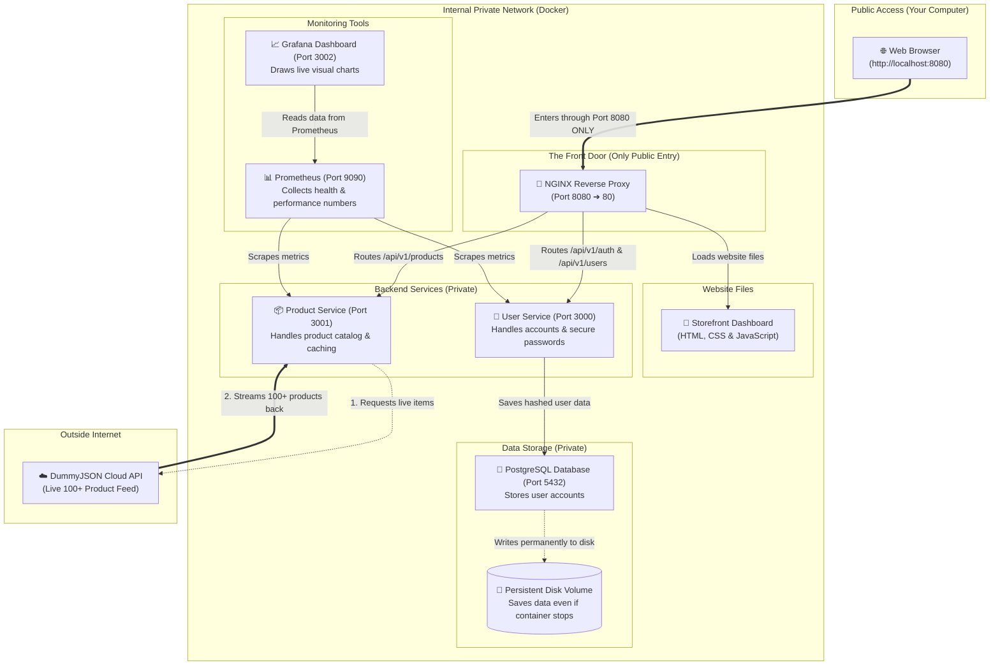

# 🚀 Cloud-Native Microservices Learning Project

A hands-on engineering project built to understand how modern cloud applications work under the hood. It takes a complete web application and breaks it down into independent, containerized services using **Docker**, **Docker Compose**, **Kubernetes**, **PostgreSQL**, and **Prometheus & Grafana**.

---

## 🏛️ System Architecture



---

## 💡 How It Works 

1. **The Single Front Door (NGINX on port 8080):**  
   Your browser only ever talks to port `8080`. NGINX acts like a receptionist—when you want to view the page, it hands you the HTML. When you click "Sign Up" or browse products, NGINX quietly forwards your request to the right backend service behind the scenes. This keeps the backend secure and prevents browser errors.

2. **Independent Microservices:**  
   Instead of one giant program, the work is split into two specialized services:
   * **User Service:** Encrypts passwords and creates accounts.
   * **Product Service:** Pulls live products and keeps them in memory for fast browsing.

3. **Safe Storage (PostgreSQL & Volumes):**  
   Normally, when a Docker container is deleted, everything inside it disappears. We attached a **Docker Volume** (a permanent folder on your hard drive) to PostgreSQL, so your registered users are never lost.

4. **Live Internet Feed:**  
   Product Service reaches out to the internet to download 100+ real marketplace items from DummyJSON, giving you a full Amazon/eBay-style catalog.

5. **Live Monitoring (Prometheus & Grafana):**  
   Prometheus automatically asks each service *"Are you healthy?"* every 5 seconds. Grafana turns those answers into real-time graphs.

---

## 📦 Microservices & Components Inventory

| Component | Container Name | Technology Stack | Container Port | Host Port | Role & Function |
| :--- | :--- | :--- | :--- | :--- | :--- |
| **Frontend** | `frontend-dashboard` | HTML5, CSS3, Vanilla JS, NGINX Alpine | `80` | `8080` | Edge reverse proxy & storefront UI |
| **User Service** | `user-service` | Node.js 20, Express, bcryptjs, JWT | `3000` | `3000` | User registration, authentication, & password encryption |
| **Product Service** | `product-service` | Node.js 20, Express, Fetch API, Cache | `3001` | `3001` | Live 100+ product marketplace catalog with fallback |
| **Database** | `postgres-db` | PostgreSQL 16 Alpine | `5432` | `5432` | Relational database with persistent volume `postgres_data` |
| **Prometheus** | `prometheus` | Prometheus v2.51.0 | `9090` | `9090` | Pull-based time-series metrics collection (`/metrics`) |
| **Grafana** | `grafana` | Grafana 10.4.0 | `3000` | `3002` | Runtime observability dashboards (Login: `admin`/`admin`) |

---

## 🚀 How to Run It

All 6 services start up together with a single command:

```bash
# Start everything in the background
docker compose up -d --build
```

### Open in your browser:
* **The Storefront Website:** [http://localhost:8080](http://localhost:8080)
* **Prometheus Metrics:** [http://localhost:9090](http://localhost:9090)
* **Grafana Charts:** [http://localhost:3002](http://localhost:3002) *(Login: `admin` / `admin`)*

### To stop everything:
```bash
docker compose down
```

---

## 🎓 Core Cloud Concepts Learned in this Project

* **Docker & Containers:** Packaging code and its exact environment so it runs identically on any computer.
* **Multi-Service Networking:** Connecting multiple isolated containers on a private network using service names instead of IP addresses.
* **Reverse Proxying:** Using NGINX as an API Gateway to hide internal services and stop CORS errors.
* **Data Persistence:** Using Docker Volumes so database records survive container restarts.
* **Kubernetes (`k8s/`) & Helm:** Preparing production manifests to deploy and auto-scale containers across a cloud cluster.
* **CI/CD Automation:** Using GitHub Actions to automatically run tests and publish Docker images on every commit.

---

## 👨‍💻 Author
**Deemantha Gunasekara**  
*Cloud & DevOps Learning Journey*
