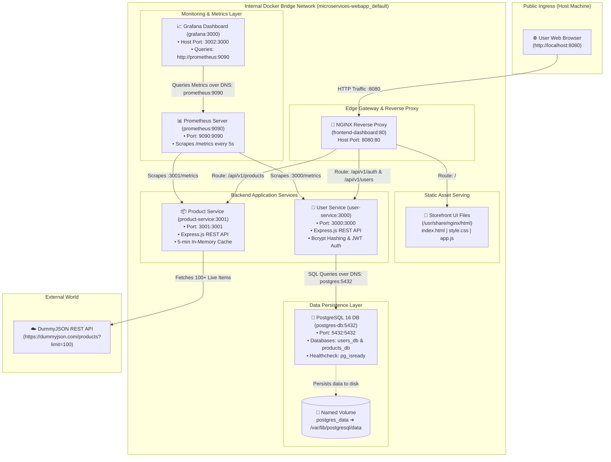

# 🚀 Cloud-Native Microservices Web Application & CI/CD Pipeline

A modern, enterprise-grade cloud-native microservices application built with **Node.js/Express** and **PostgreSQL**, containerized with **Docker**, orchestrated locally via **Docker Compose**, deployed on **Kubernetes** using **Helm**, monitored with **Prometheus & Grafana**, and automated end-to-end with **GitHub Actions CI/CD** publishing to **GitHub Container Registry (GHCR)**.

---

## 🏛️ Comprehensive System Architecture & Network Topology



---

### 🔍 Architectural Highlights & Request Lifecycle Breakdown

1. **Single Entry Point (No CORS Issues):**  
   The browser only ever communicates with **`http://localhost:8080`**. It never directly addresses the backend ports (`3000`, `3001`). NGINX acts as a reverse proxy, dispatching requests internally across the private Docker network based on URL prefixes. This eliminates browser Cross-Origin Resource Sharing (CORS) security restrictions.

2. **Docker Internal DNS Resolution:**  
   Services communicate using container service names (`user-service`, `product-service`, `postgres`, `prometheus`), never hardcoded IP addresses. Docker's built-in DNS resolves these names dynamically.

3. **Stateless Compute & Stateful Persistence:**  
   The Node.js and NGINX containers are completely stateless and can be destroyed or scaled instantly. The PostgreSQL container delegates all storage to a persistent named volume (`postgres_data`), ensuring user records survive container updates and system reboots.

4. **Multi-Stage Resilient Catalog:**  
   Product Service streams live items from DummyJSON, stores them in an in-memory cache for 5 minutes (`TTL = 300s`) to avoid rate limits, and automatically falls back to an embedded offline catalog if the external API becomes unreachable.

---

## 📦 Microservices & Components Inventory

| Component | Container Name | Technology Stack | Container Port | Host Port | Role & Function |
| :--- | :--- | :--- | :--- | :--- | :--- |
| **Frontend** | `frontend-dashboard` | HTML5, CSS3, Vanilla JS, NGINX Alpine | `80` | `8080` | Edge reverse proxy & warm-minimalist storefront UI |
| **User Service** | `user-service` | Node.js 20, Express, bcryptjs, JWT | `3000` | `3000` | User registration, authentication, & password encryption |
| **Product Service** | `product-service` | Node.js 20, Express, Fetch API, Cache | `3001` | `3001` | Live 100+ product marketplace catalog with fallback |
| **Database** | `postgres-db` | PostgreSQL 16 Alpine | `5432` | `5432` | Relational database with persistent volume `postgres_data` |
| **Prometheus** | `prometheus` | Prometheus v2.51.0 | `9090` | `9090` | Pull-based time-series metrics collection (`/metrics`) |
| **Grafana** | `grafana` | Grafana 10.4.0 | `3000` | `3002` | Runtime observability dashboards (Login: `admin`/`admin`) |

---

## 🎨 Interactive Storefront & Figma Design

The storefront was implemented from an approved design prototype:
* **Figma Prototype:** [View Interactive Figma Design File](https://www.figma.com/design/kRuLq69u2qHeGSwwy1kitA)
* **Warm Minimalist Palette:** Built with clean CSS custom properties (`--primary-accent: #c85a32`, warm sand backgrounds, elevated card surfaces).
* **100+ Live Marketplace Feed:** Dynamic multi-category catalog across smartphones, laptops, electronics, automotive, watches, and home essentials.
* **Instant Client Filtering:** Zero-latency category pill selection and real-time title/description keyword search.
* **In-Browser PostgreSQL Registration:** Interactive Sign-Up modal writing bcrypt-hashed user credentials directly to PostgreSQL.
* **Live Database Table Viewer:** Built-in modal viewer to inspect live PostgreSQL `users_db.users` records.

---

## 🚀 Quickstart Options

### Option 1: Run with Docker Compose (Local Development)

Start the entire 6-container microservices stack in one command:

```bash
docker compose up -d --build
```

#### Access Endpoints:
* **Storefront Dashboard:** [http://localhost:8080](http://localhost:8080)
* **User Service API:** [http://localhost:3000/api/v1/users](http://localhost:3000/api/v1/users)
* **Product Service API:** [http://localhost:3001/api/v1/products](http://localhost:3001/api/v1/products)
* **Prometheus Targets:** [http://localhost:9090/targets](http://localhost:9090/targets)
* **Grafana Dashboards:** [http://localhost:3002](http://localhost:3002) *(Login: `admin` / `admin`)*

To stop all containers:
```bash
docker compose down
```

---

### Option 2: Deploy with Helm (Kubernetes)

Package and deploy all microservices and Ingress using Helm:

```bash
# Deploy or upgrade the Helm chart in the microservices-app namespace
helm upgrade --install microservices-app ./helm/microservices-app \
  --namespace microservices-app \
  --create-namespace
```

Inspect deployed resources:
```bash
kubectl get all,ingress -n microservices-app
```

To uninstall:
```bash
helm uninstall microservices-app -n microservices-app
```

---

### Option 3: Deploy with Raw Kubernetes Manifests

```bash
# 1. Create Namespace
kubectl apply -f k8s/namespace.yaml

# 2. Deploy Services, Deployments, PVCs, and Ingress
kubectl apply -f k8s/
```

Access the application via NGINX Ingress at:
* **Dashboard:** [http://localhost/](http://localhost/)
* **Users API:** [http://localhost/api/v1/users](http://localhost/api/v1/users)
* **Products API:** [http://localhost/api/v1/products](http://localhost/api/v1/products)

---

## 🔒 Secret Management & DevOps Hygiene

This project enforces strict cloud-native secret handling standards:

* **No Hardcoded Secrets:** `.env` and credential files are strictly excluded via `.gitignore`.
* **Sanitized Template (`.env.example`):** The repository provides a clean `.env.example` documenting all configuration keys without exposing real values.
* **CI/CD Injection:** GitHub Actions workflows dynamically inject secrets at build/test time using `${{ secrets.VARIABLE_NAME }}`.
* **Kubernetes Secrets:** In Kubernetes, credentials are decoupled from application pods and mounted securely via `Secret` and `ConfigMap` resources.

---

## 🔄 CI/CD Pipeline Architecture

This repository uses automated **GitHub Actions** workflows:

1. **Continuous Integration (`.github/workflows/ci.yml`):**
   * Automatically triggered on pull requests and pushes to `main`.
   * Sets up Node.js 20 on Ubuntu runners.
   * Runs clean dependency installation (`npm ci`).
   * Executes unit and integration test suites via Jest & Supertest across all backend services in parallel.

2. **Continuous Delivery (`.github/workflows/cd.yml`):**
   * Automatically triggered on pull requests (test build) and pushes to `main` (build & push).
   * Authenticates with **GitHub Container Registry (GHCR)** using `${{ secrets.GITHUB_TOKEN }}`.
   * Compiles multi-stage, non-root Alpine Docker images for `user-service`, `product-service`, and `frontend`.
   * Publishes images tagged with `:latest` and `:sha-<commit>` directly to GitHub Packages.

---

## 🛡️ Security Best Practices Implemented

* **Unprivileged Non-Root Containers:** All Node microservices run under `USER node` and NGINX runs on Alpine to minimize attack surfaces.
* **Kubernetes Resource Governance:** Every pod has strict CPU and Memory `requests` and `limits` to prevent noisy-neighbor starvation.
* **Zero-Downtime Rolling Releases:** Combined `readinessProbe` and `livenessProbe` with `maxUnavailable: 0` ensures zero-downtime updates.
* **Path-Based Reverse Proxying:** NGINX handles clientside API requests internally, eliminating browser CORS vulnerabilities.

---

## 👨‍💻 Author
**Deemantha Gunasekara**  
*Cloud & DevOps Engineering Project*
